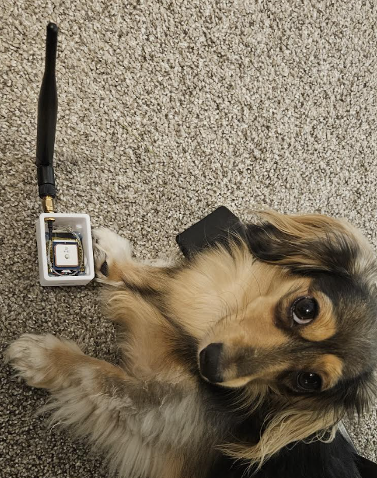
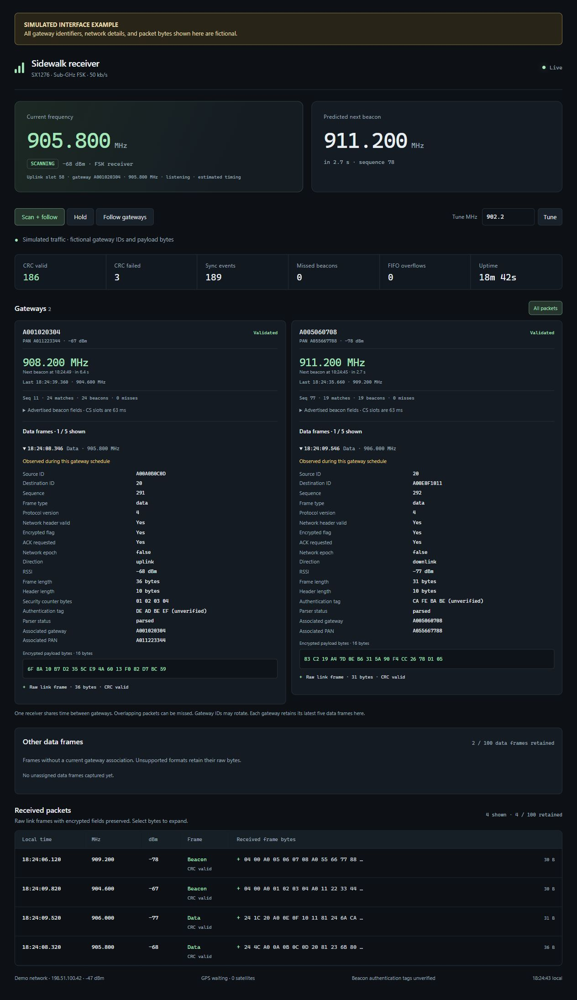

# ESP32 Sidewalk receiver

This Amazon Sidewalk receiver has successfully tracked multiple gateways and followed their scheduled frequency hops. It captures packet headers and displays encrypted payload bytes for supported frame formats, with a local web interface for inspecting traffic from each gateway.

The project provides a foundation for analyzing Sidewalk traffic and exploring changes to how devices interact with the network. Decryption is outside its scope. Possible extensions include estimating device locations from GNSS-tagged Sidewalk observations, or estimating an observer's location by comparing gateway sightings with previously mapped observations.



The receiver uses a classic ESP32 and an SX1276 radio. Its dashboard shows gateway identifiers, reception times, current and predicted frequencies, RSSI, frame bytes, and data-packet metadata.

The SX1276 operates in 50 kb/s FSK mode. Reception uses a 69-channel plan from 902.2 to 915.8 MHz. Live testing validated CRC-checked beacon reception, frequency-hop prediction, multi-gateway following, and the web dashboard. Data-slot listening is implemented, and data-frame parsing is covered by synthetic tests. Live encrypted application-payload capture is the remaining verification step for that feature.

## Hardware and wiring

Use an ESP32 Dev Module, an SX1276 module suitable for the 900 MHz band, an antenna, and a USB data cable. The power connections below assume a 3.3 V SX1276 module. Pin labels are ESP32 GPIO numbers.

```text
       ESP32                         SX1276
  +----------------+            +----------------+
  |           3V3  |------------| VCC            |
  |           GND  |------------| GND            |
  |                |            |                |
  | GPIO5   (SCK)  |----------->| SCK            |
  | GPIO19 (MISO)  |<-----------| MISO           |
  | GPIO25 (MOSI)  |----------->| MOSI           |
  | GPIO18  (CS)   |----------->| NSS / CS       |
  | GPIO16         |----------->| RESET          |
  | GPIO27         |<-----------| DIO0           |
  +----------------+            |                |
                                | ANT -----------+-- Antenna
                                +----------------+
```

GNSS is optional. The retained diagnostic input uses GPIO34 as RX at 9600 baud and GPIO12 as TX. The receiver works with only the SX1276 connected. GPIO2 provides a reception LED signal.

## Build and flash

Install PlatformIO Core or the PlatformIO IDE extension. Open this repository's root directory, which contains the public `platformio.ini`.

1. Copy `esp32_s2Compatible_loraTest_RX_baseStationForMap/include/Secrets.example.h` to `Secrets.h` in the same directory.
2. Enter your own 2.4 GHz Wi-Fi network name and password in `Secrets.h`. Git ignores this file.
3. Run `pio run -e esp32dev` from the repository root.
4. Flash using `pio run -e esp32dev -t upload --upload-port YOUR_PORT`. Replace `YOUR_PORT` with the ESP32's serial port, such as `COM36` on Windows or `/dev/ttyUSB0` on Linux.
5. Open the serial monitor at 115200 baud using `pio device monitor --port YOUR_PORT --baud 115200`.

The serial output prints the assigned web-interface address. Open that address on the same network, or try [sidewalk-rx.local](http://sidewalk-rx.local/). The build uses placeholder credentials until you supply `Secrets.h`.

## Dashboard



*Simulated example. The developer is unsure what the applicable terms of service (TOS) permit for sharing captured traffic, so all gateway identifiers, network details, and packet bytes shown here are fictional.*

- Scan + follow discovers gateways and follows known beacon schedules while listening on data opportunities.
- Hold keeps the receiver on its current frequency. Tune selects a frequency from 902 to 928 MHz.
- Gateway cards show opaque gateway/PAN identifiers, beacon timing, predicted frequencies, and advertised connection, power, load, and shared-slot fields.
- Each card displays up to five recently retained data frames. Supported headers expose source/destination fields, sequence numbers, ACK flags, network security settings, authentication bytes, security counters, and the extracted payload region.
- Ciphertext is labeled when a supported network header enables encryption. Unsupported layouts retain complete raw bytes with an explicit parser status.
- Schedule-based gateway association is labeled. Directly matching a visible gateway identifier provides a separate association category.

The firmware retains 48 mixed frames and 32 non-beacon frames in RAM. The browser retains up to 100 records in each history. Reloading the page reconstructs its history from the ESP32's current buffers. Rebooting clears the receiver's histories.

## Reception and validation

Startup tests cover published AN633 PHY examples, synthetic beacon/message fixtures, bit corruption, truncation, variable-length headers, data-channel vectors, and timer/sequence rollover. The receiver starts only when its self-tests pass.

Live validation received five gateway/PAN identifiers and 77 CRC-valid frames. Independent comparisons confirmed the received channels against the hopping calculation, and the receiver recorded zero FIFO overflows during that check. The browser's gateway filtering, full-frame expansion, and hold/resume controls were also checked on the running receiver. Local RF recordings and receiver coordinates are excluded from this repository.

Public shared FSK slots are followed from advertised schedules. Other hopping slots are sampled. The data scheduler estimates slot zero at 140 ms before the beacon SFD, with listening windows extending 24 ms before and 58 ms after target time. The dashboard marks this timing as estimated. A three-minute development check received beacons and no supported data frames, so over-the-air ciphertext extraction still requires validation.

A single radio shares reception time across gateways. Overlapping transmissions and short or weak signals can be missed. This firmware supports SubG-FSK reception. Authentication tags are exposed without cryptographic verification, and encrypted bytes are displayed as ciphertext. The web interface provides local receiver controls without an authentication layer.

## References and licensing

Protocol fields and hopping calculations follow the [Amazon Sidewalk specification](https://docs.sidewalk.amazon/specifications/sidewalk-protocol-spec/sub-ghz-protocol-stack/protocol-stack-layers-and-structure.html) and its [SubG-FSK connection description](https://docs.sidewalk.amazon/specifications/sidewalk-protocol-spec/sub-ghz-protocol-stack/subgfsk-connection.html). This is an independent implementation for ESP32 and SX1276.

Third-party licensing is recorded in [THIRD_PARTY.md](THIRD_PARTY.md). A license for the project's original source has not yet been selected.
